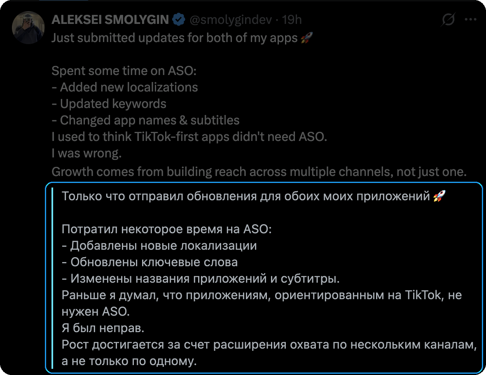
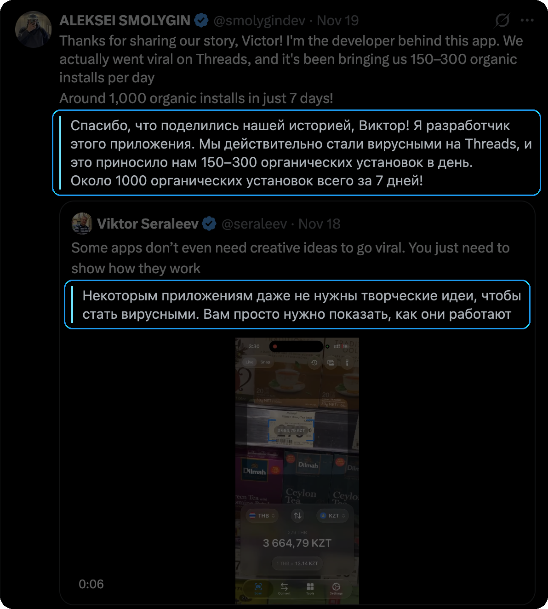

<p align="center">
  
</p>

<h1 align="center">X Reply Translator</h1>

<p align="center">
  Читайте X на русском и отвечайте на английском, не выходя из вкладки.
</p>

<p align="center">
  <a href="LICENSE"></a>
  
  <a href="https://t.me/lexa205dev"></a>
</p>

<p align="center">
  
</p>

> **In English:** a free Chrome extension for people who grow an English-speaking audience on X but think in Russian. It shows a Russian translation under every tweet and turns a reply typed in Russian into English right inside the reply box. The interface is in Russian.

## Зачем

Чтобы растить англоязычную аудиторию в X, нужно каждый день отвечать на чужие твиты. Если английский не родной, один ответ превращается в цепочку: скопировать твит, перевести, написать ответ по-русски, перевести, скопировать, вернуться в X, вставить. Расширение убирает все шаги, кроме двух: прочитать и написать.

## Что умеет

- **Перевод твитов.** Под каждым нерусским твитом в ленте появляется перевод на русский. Длинные твиты переводятся целиком после нажатия «Show more».

<p align="center">
  
  <br />
  <em>Переводится и сам твит, и цитата внутри него</em>
</p>

- **Перевод ответов.** Пишете по-русски прямо в поле ответа, нажимаете `⌥T` (`Alt+T`) или кнопку **RU → EN** — текст заменяется английским. Сочетание клавиш можно поменять.
- **Возврат исходника.** Русский текст остаётся под полем. Кнопка «Вернуть русский» возвращает его, если хочется поправить и перевести заново.
- **Живой английский через языковую модель.** С ключом API ответ переводит модель, которая видит твит, на который вы отвечаете, и пишет так, как пишут в X. Подходят OpenAI, Anthropic, Gemini, OpenRouter, DeepSeek, xAI, Mistral и любой сервис с OpenAI-совместимым API. Без ключа работает Google Translate.
- **Свой системный промпт.** Инструкцию для модели можно переписать под свой стиль: тон, длину, сленг.

## Установка

Расширения пока нет в Chrome Web Store, оно ставится из папки:

1. Скачайте репозиторий: зелёная кнопка **Code → Download ZIP**, затем распакуйте архив. Или `git clone https://github.com/capsmol/x-reply-translator.git`.
2. Откройте `chrome://extensions`.
3. Включите «Режим разработчика» справа вверху.
4. Нажмите «Загрузить распакованное расширение» и выберите папку с проектом.
5. Обновите вкладку с X.

Проверено в Chrome. В других браузерах на Chromium (Arc, Brave, Edge, Яндекс Браузер) должно работать так же.

## Настройки

Клик по иконке расширения открывает окно настроек с тремя вкладками — «Основное», «Модель» и «Промпт»:

- **Автоматически переводить твиты.** Можно выключить, если нужен только перевод ответов.
- **Горячая клавиша.** По умолчанию `⌥T` (`Alt+T`). Кликните в поле и нажмите своё сочетание.
- **Модель для перевода ответов.** Выберите провайдера из списка — адрес API и модель подставятся сами, останется вставить ключ. Название модели можно поменять на любое, которое поддерживает провайдер. Пункт «Другой» принимает адрес любого OpenAI-совместимого API. После сохранения браузер спросит разрешение на доступ к адресу провайдера (для OpenAI не спрашивает).
- **Системный промпт.** Инструкция, по которой модель переводит черновик. Кнопка «Вернуть стандартный» восстанавливает исходный текст.

| Провайдер | Модель по умолчанию |
|---|---|
| OpenAI | `gpt-5.1` |
| Anthropic | `claude-sonnet-5-5` |
| Google Gemini | `gemini-2.5-flash` |
| OpenRouter | `openai/gpt-5.1` |
| DeepSeek | `deepseek-chat` |
| xAI | `grok-4` |
| Mistral | `mistral-large-latest` |

Ключ нужен именно от API провайдера. Подписки вроде ChatGPT Plus или Claude Pro доступа к API не дают.

## Сколько это стоит

Расширение бесплатное. Перевод твитов идёт через Google Translate и тоже ничего не стоит.

Платите вы только своему провайдеру и только если указали ключ. На `gpt-5.1` один переведённый ответ обходится примерно в $0,001, при 50 ответах в день это около $1,5 в месяц.

## Приватность

- У расширения нет своего сервера, аналитики и трекеров.
- Текст твитов, которые вы видите в ленте, отправляется в Google Translate.
- Ваш черновик и твит, на который вы отвечаете, отправляются выбранному провайдеру модели, если указан ключ. Без ключа черновик уходит в Google Translate.
- Ключ API хранится только в локальном хранилище браузера и недоступен скриптам страницы.

## Ограничения

- Перевод твитов использует неофициальный адрес Google Translate. При очень быстром скролле он может на время перестать отвечать.
- Расширение опирается на разметку X. Если X её поменяет, панель под полем ответа может пропасть до обновления расширения. В таком случае [создайте issue](https://github.com/capsmol/x-reply-translator/issues).

## Разработка

Обычный JavaScript без сборки и зависимостей.

```
npm test
```

| Файл | Что делает |
|---|---|
| `src/content.js` | Работает на странице X: переводы под твитами, панель под полем ответа, горячая клавиша |
| `src/background.js` | Принимает запросы на перевод и хранит доступ к ключу |
| `src/translate.js` | Запросы к Google Translate и к API модели |
| `src/hotkey.js` | Разбор и отображение горячей клавиши |
| `src/options.html`, `src/options.js`, `src/options.css` | Окно настроек и список провайдеров |

## Автор

Алексей Смолыгин. Telegram-канал: [@lexa205dev](https://t.me/lexa205dev).

## Лицензия

[MIT](LICENSE)
